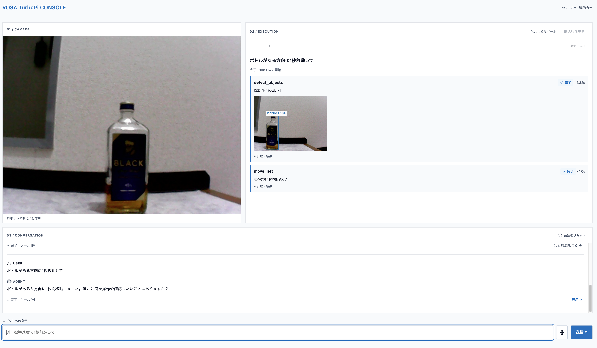

# rosa-turbopi

日本語で[TurboPi](https://www.hiwonder.com/products/turbopi?variant=40112905388119)を操作するPythonアプリです。[NASA JPL ROSA](https://github.com/nasa-jpl/rosa) を使い、移動・物体検出をCLIやWeb UIから実行できます。Webではカメラ映像・実行履歴の表示と音声入力にも対応します。



実機ではTurboPiの既存Dockerコンテナに接続し、移動・状態取得にはrosbridge、カメラ画像の取得にはHTTPを使います。

## セットアップ

Docker ComposeまたはPython・uvで実行できます。リポジトリのルートで実行してください。

```sh
cp .env.example .env
mkdir -p weights
```

`.env` の主な設定:

| 変数 | 内容 |
|---|---|
| `ROBOT_BACKEND` | 実機は `rosbridge`、機体なしで試す場合は `mock` |
| `ROSBRIDGE_HOST` / `ROSBRIDGE_PORT` | 実機の接続先。既定は `127.0.0.1:9090` |
| `ENABLE_MOTION` | 実機の移動・停止を有効にする。既定は `true` |
| `OPENAI_API_KEY` / `LLM_MODEL` | 会話用のキーとツール呼び出し対応モデル |
| `OPENAI_BASE_URL` | Responses API対応の別エンドポイントを使う場合に指定 |
| `VOICE_OPENAI_API_KEY` | 音声文字起こし専用のキー。会話用キーとは独立 |

全設定は [.env.example](.env.example) を参照してください。

実機ではTurboPiの既存Dockerコンテナが起動している必要があります。物体検出のモデルは初回検出時にダウンロードされます。

### Docker Composeで実行

```sh
docker compose build
```

### ローカルで実行

Python 3.11 / 3.12とuvが必要です。Dockerと同じ `.env` を使います。

```sh
uv sync --frozen
```


## Web UI

どちらか一方で起動します。

```sh
# Docker
docker compose run --rm --entrypoint rosa-turbopi-web rosa

# ローカル
uv run rosa-turbopi-web
```

起動したホストのブラウザで [http://127.0.0.1:8000](http://127.0.0.1:8000) を開きます。カメラ映像、チャット、ツール実行履歴を表示し、実行の中断や会話のリセットができます。

音声入力を使う場合は、上のサーバーを終了して次を起動します。

```sh
# Docker
docker compose run --rm --entrypoint rosa-turbopi-voice-web rosa

# ローカル
uv run rosa-turbopi-voice-web
```

録音の文字起こしを入力欄で確認・修正してから送信します。ブラウザのマイク許可が必要です。音声用キーは `VOICE_OPENAI_API_KEY`、モデルは `VOICE_TRANSCRIBE_MODEL` で設定します。

```sh
ssh -N -L 8000:127.0.0.1:8000 pi@<Piのアドレス>
```

## CLI

Docker:

```sh
docker compose run --rm rosa check
docker compose run --rm rosa battery
docker compose run --rm rosa chat

# LLMを使わず直接操作
docker compose run --rm rosa move --vx 0.5 --duration 0.5
docker compose run --rm rosa stop
```

ローカル:

```sh
uv run rosa-turbopi check
uv run rosa-turbopi battery
uv run rosa-turbopi chat

# LLMを使わず直接操作
uv run rosa-turbopi move --vx 0.5 --duration 0.5
uv run rosa-turbopi stop
```

チャットでは `/status` で状態確認、`/stop` で停止、`/quit` で終了します。モックを使う場合は `.env` に `ROBOT_BACKEND=mock` を設定してください。モックのチャットも外部LLM APIを利用します。

## 開発

Python 3.11 / 3.12とuvでローカル実行できます。

```sh
uv sync --frozen
uv run ruff check .
uv run ruff format --check .
uv run pytest
```

テストは実機・外部LLM APIへ接続しません。

## 詳細ドキュメント

- [アーキテクチャ](docs/architecture.md): 構成、実行管理、Web・カメラ・認識の仕組み
