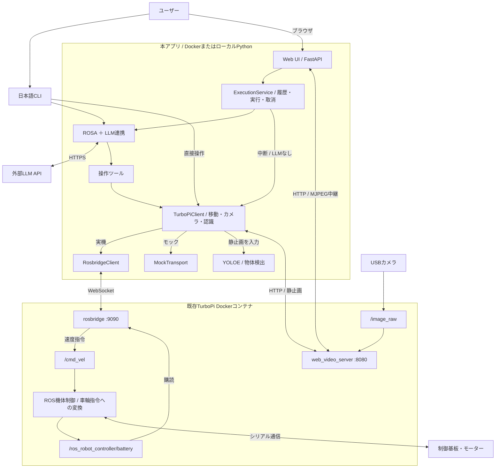
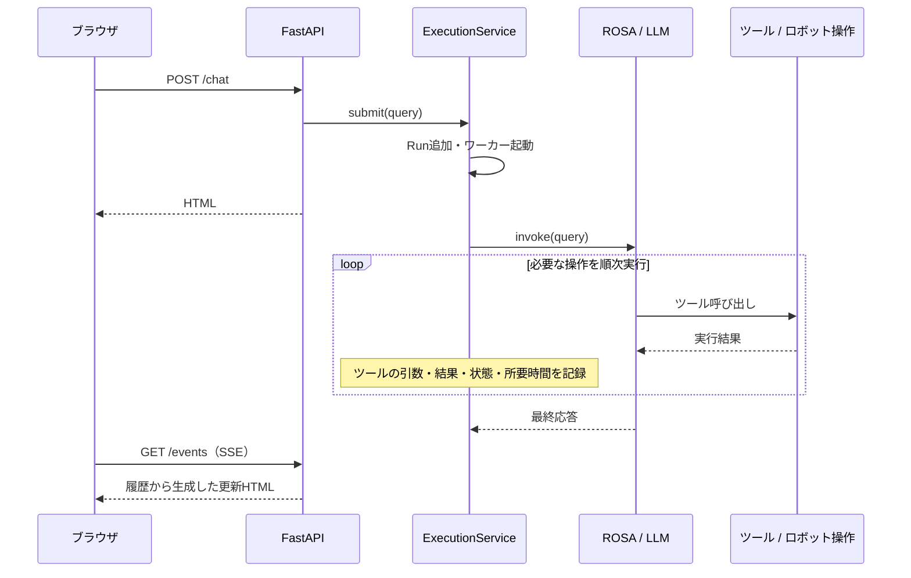
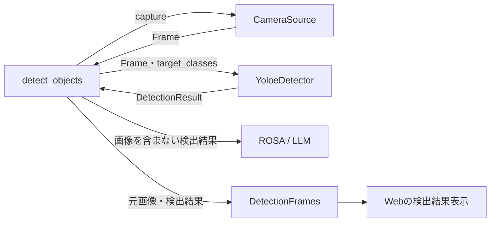

# アーキテクチャ

起動方法と設定は[README](../README.md)を参照してください。

## 全体構成

LLMがツールと引数を選び、Pythonが操作の実行と制約を担い、既存TurboPiのROS・制御基板が機体を制御します。本アプリはDocker ComposeまたはローカルのPythonプロセスで動作します。

実機の既存Dockerコンテナには、移動・状態取得はrosbridge（WebSocket）、カメラ画像の取得は `web_video_server`（HTTP）で接続します。既存コンテナの変更やDockerソケットの共有は不要です。

`ROBOT_BACKEND=mock` では `MockTransport` と `MockCamera` を使い、機体へ接続しません。チャットはモックでも外部LLM APIを利用します。

例えば「左に1秒移動して」は、ROSAとLLMが `move_left(duration_s=1)` に変換します。移動ツールは速度・時間を検証する実行処理を呼び、定周期の指令送信と最後のゼロ速度送信が終わってから結果を返します。LLMはその結果を説明します。

## コードの役割

| 場所 | 責務 |
|---|---|
| `cli.py` | 日本語対話・直接操作・接続の生存期間 |
| `agent.py` / `prompts.py` | ROSAとLLMの組み立て・操作判断と報告のルール |
| `tools/` | LLM向けの操作説明・入力スキーマ・結果の返却 |
| `robot/client.py` | 移動・カメラ・検出画像の保管をまとめる窓口 |
| `robot/motion.py` | 速度・時間の検証、定周期送信、取消、終了時のゼロ速度送信 |
| `robot/camera/` / `robot/perception/` | 静止画の取得・物体検出・検出画像の保管 |
| `transport/` | CLIとWeb共通のtransport生成、rosbridge通信・モック |
| `execution/` | Webからの指示実行、履歴、ツール呼び出しの記録・取消 |
| `web/` | HTTPルート、HTML生成、SSE、ブラウザ側の表示制御 |
| `rosa_turbopi_voice/` | 録音UI・文字起こしAPI・音声用設定 |

## LLMとツール

`RosbridgeROSA._get_tools` をオーバーライドし、ROSA標準のROS CLI・システム操作ツールを登録せず、本アプリのツールだけを使います。ROSA 1.0.10の内部フックへの依存があるため、更新時は登録経路のテストが必要です。

`tools/catalog.py` をROSAへの登録とWebのツール一覧の共通定義元にします。状態取得は両バックエンドで利用でき、移動・停止はモック、または実機の `ENABLE_MOTION=true` 時に登録します。`detect_objects` は両方に登録しますが、モックでは撮影せず失敗を返します。

システムプロンプトは、省略された引数の補完、複数操作の組み立て、順次実行、失敗時の中止、結果の報告を定めます。単位・範囲・速度の既定値・距離や角度からの時間の概算方法は各ツールの説明に置きます。速度・時間の制限はコードでも検証しますが、動作の選択や計画はLLMの判断です。

ツール一覧は説明文と入力スキーマから生成し、日本語名・引数・必須／任意・既定値を表示します。一覧の取得はLLMの生成やツール実行を伴わないため、APIキーがなくても利用できます。

## 指示の実行と移動

CLIのチャットは `agent.invoke()` の終了を待ちます。Webでは `ExecutionService.submit()` がワーカースレッドを起動し、HTTPリクエストは実行完了を待ちません。どちらも移動ツールは `MotionExecutor.start()` の後に `join()` で終了を待ちます。

`MotionExecutor` は速度・時間を検証し、10 Hzで速度指令を送り、終了時にゼロ速度を送信します。同時の移動開始は拒否します。状態は `idle`、`running`、`completed`、`cancelled`、`failed` で、引数不正などはツールが `rejected` として返します。

`completed` は指令処理の完了です。距離・角度や物理的な停止をセンサーで確認した結果ではありません。通信断・プロセス強制終了時の停止は保証できず、他の操作元が同じ `/cmd_vel` に送信する場合も競合します。

CLIの `/status`・`/stop` と直接コマンドはLLMを経由しません。ただし、チャットの移動実行中やLLM応答待ちには次の入力を処理できません。終了時は移動停止を試みてからtransportを閉じます。別CLIの `stop` は、元のプロセスの送信ループ自体を取り消すものではありません。

## Webの共有状態・更新・中断

### 画面とファイル

FastAPI・Jinja2・htmxを使い、htmxとSSE拡張はローカルに同梱します。起動時にtransport、`TurboPiClient`、`ExecutionService` を作成し、ROSAは最初の指示で生成して会話中に再利用します。

| 場所 | 表示・処理の担当 |
|---|---|
| `web/templates/index.html` | カメラ、入力欄、ツール一覧ダイアログ |
| `web/templates/partials/workspace.html` | 実行タイムライン、会話履歴、通知 |
| `web/templates/partials/tools.html` | 利用可能なツールの詳細 |
| `web/static/app.js` | 履歴選択、応答の競合対策、スクロール、ボタン状態 |
| `web/static/camera.js` | MJPEGの解析・表示・再接続 |
| `execution/store.py` | 指示ごとの `Run` データモデル |

### 共有状態と画面更新

全ブラウザで会話・接続・実行履歴を共有するため、Webは単一プロセス・単一ワーカーで動かします。同時に実行できる指示は1件です。認証・セッション分離・履歴の永続化はなく、実行履歴の件数制限もありません。

SSEは0.5秒ごとに履歴をコピーしてHTMLを生成し、前回と異なる場合に送信します。再接続時は現在の表示を送り直します。過去の実行を選んだ状態は更新時も維持しますが、新しい指示が追加されると最新の実行へ切り替えます。

実行タイムラインは予定表ではなく、実際に呼び出したツールのID・名前・引数・結果・状態・所要時間を `Run.id` ごとに表示します。時刻はUTCで記録し、画面では日本時間に変換します。短時間で終了するツールでは、SSEの間隔によって実行中の表示を挟まず完了状態が届くことがあります。変化のない場合はkeepaliveを送ります。

### 中断と会話リセット

中断はLLMを介さず、取消フラグと後続移動のブロックを設定し、移動の取消・ゼロ速度送信を行います。後続のツール呼び出しも拒否します。進行中のLLM通信や、すでに開始した読み取り・推論を強制終了する仕組みはなく、ワーカー終了までは次の指示やリセットを受け付けません。

会話リセットは実行終了後に履歴・検出画像・ROSAインスタンスを破棄します。ロボット接続は維持し、次の指示で新しいROSAを生成します。終了時は新規受付を止め、取消・移動停止を試みて接続を閉じます。

取消には `ExecutionService` のフラグと `MotionExecutor.block(True)` を使います。次の指示を受け付けるときに取消フラグと移動ブロックを解除します。会話リセットは全ブラウザへ反映され、ブラウザを再読み込みしただけでは履歴は消えません。

## カメラと物体検出

ライブ映像と推論用画像は別経路です。

| 用途 | 経路 |
|---|---|
| Webのライブ映像 | `GET /camera/stream` が上流のMJPEGを中継し、`camera.js` がJPEGフレームを表示 |
| 静止画 | `HttpSnapshotCamera.capture()` が上流の `/snapshot` から `Frame` を取得 |
| 物体検出 | `detect_objects` が撮影し、`YoloeDetector.detect(frame, target_classes)` で推論 |
| 検出結果の表示 | 保管した元画像と検出結果をタイムラインのiframeで表示 |

カメラ欄はSSEの更新領域から分離しているため、チャット更新で映像は再接続しません。モックではライブ映像を取得せず、検出も行いません。`GET /camera` だけは固定SVGを返します。

`CameraSource.capture()` が返す `Frame` はフレームID・撮影時刻・画像バイト列・メディアタイプを持ちます。実機の静止画取得先とMJPEG中継先は `ROSBRIDGE_HOST`・`CAMERA_PORT`・`CAMERA_TOPIC` を共用します。上流の接続・読み取りには `CAMERA_TIMEOUT_S` を適用します。

ライブ映像は取得失敗・ストリーム終了時に3秒後に再接続し、タブ非表示時には取得を中断します。ブラウザ切断や上流エラー時は中継接続を閉じます。

YOLOEと画像デコード用ライブラリは初回検出時に読み込みます。推論はアプリ側で実行し、検出器はカメラに依存せず `Frame` を入力にします。ツール結果はフレームID・画像サイズ・ラベル・信頼度・bbox・画像内の左右位置を含み、画像バイト列はLLMへ渡しません。距離は測定しません。

撮影失敗は `stage: capture`、推論失敗は `stage: inference`、検出0件は `completed` と空の一覧で区別します。検出自体は移動しませんが、移動を含む依頼ではLLMが別の移動ツールを組み合わせることがあります。

`DetectionFrames` は元画像と検出結果をメモリに保管し、最大20件・画像バイト列の合計64 MiBを超えると古いものから破棄します。画像のディスク保存やMJPEGの常時推論は行いません。

`/detections/{frame_id}` は元画像・bbox・ラベル・信頼度をSVGで描画し、`/detections/{frame_id}/image` は元画像を返します。検出画像はタイムライン内で表示し、ライブ映像のカメラ欄は切り替えません。画像が保管上限で破棄されると、対応する画像や表示ページは取得できなくなります。

## HTTPルート

| メソッド・パス | 役割 |
|---|---|
| `GET /` | 初期画面 |
| `POST /chat` | 指示の受付 |
| `GET /runs/{run_id}` | 選択した実行の表示 |
| `GET /events` | SSEによる画面更新 |
| `POST /stop` | 指示の取消・移動停止 |
| `POST /conversation/reset` | 会話・履歴のリセット |
| `GET /tools` | ツール説明・入力スキーマの表示。LLM設定不要 |
| `GET /camera` | 静止画 |
| `GET /camera/stream` | MJPEG中継。モックでは204 |
| `GET /detections/{frame_id}` | 検出結果の表示ページ |
| `GET /detections/{frame_id}/image` | 検出に使った元画像 |
| `POST /voice/transcribe` | 音声拡張のみ。文字起こし結果を返す |

## 音声入力

音声拡張は既存Webアプリに録音UIと文字起こしルートを追加します。文字起こしは `VOICE_OPENAI_API_KEY` を使い、会話用の `OPENAI_API_KEY`・`OPENAI_BASE_URL` から独立しています。認識結果は入力欄へ戻し、送信は利用者が行います。

録音には操作端末のマイクを使い、音声を `POST /voice/transcribe` からサーバー経由で `https://api.openai.com/v1/audio/transcriptions` へ送ります。APIキーはサーバー側で保持し、ブラウザへ渡しません。文字起こしルートは認識結果だけを返し、指示を直接実行しません。

`rosa_turbopi_voice/app.py` がベースの `create_app()` にルートと静的ファイルを追加し、トップページに音声用JS・CSSを差し込みます。ロボット接続や実行サービスはベースと共有します。依存は音声拡張からベースへの一方向です。`voice.js` は既存フォームのID・htmxイベントに依存するため、フォームを変更する際は音声入力も確認します。

| 項目 | 制限・設定 |
|---|---|
| 音声モデル | `VOICE_TRANSCRIBE_MODEL`（既定 `gpt-transcribe`） |
| サーバーの受信形式 | WebM・MP4・WAVのraw body |
| 録音時間・容量 | ブラウザで最大30秒、ブラウザ・サーバー双方で最大4 MiB |
| 同時文字起こし | 1件 |
| API通信 | タイムアウト45秒、自動再試行なし |
| 認識テキスト | 空文字を拒否、最大4000文字 |

`Transcriber` インターフェースで文字起こしを抽象化し、OpenAIとの通信・結果検証・エラー変換は `providers/openai.py` に置きます。音声はブラウザとサーバーのメモリで処理し、アプリ側でディスクや会話履歴へ保存しません。

## 検証

テストは通信モック・仮想時計・テスト用LLMで、ツール登録、移動制約、停止、Webの実行・取消・リセット、カメラ中継、検出結果を検証します。JavaScriptのテストは表示制御やMJPEG解析などを検証します。実機・外部APIでの動作やブラウザ上の見た目は別途確認が必要です。
