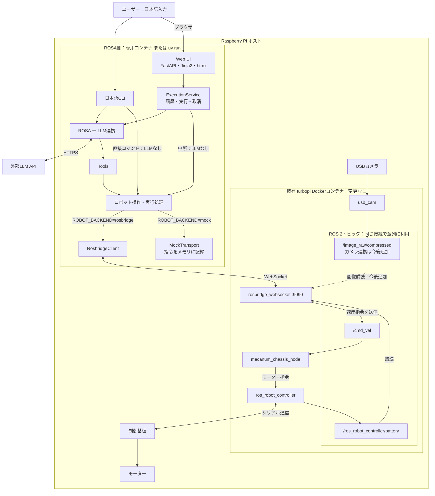
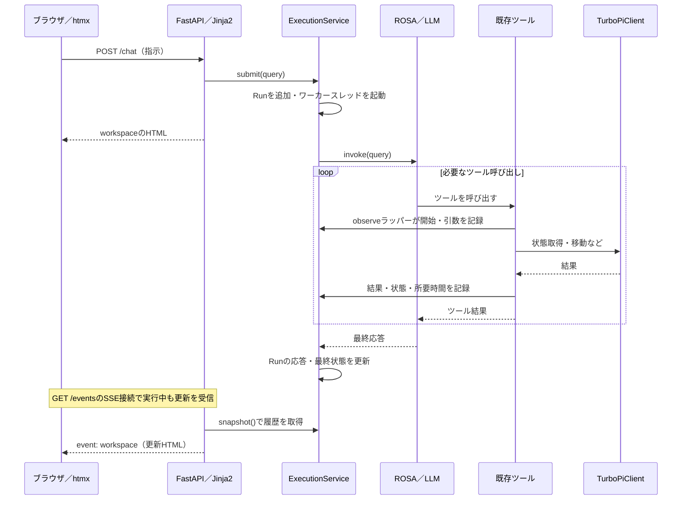
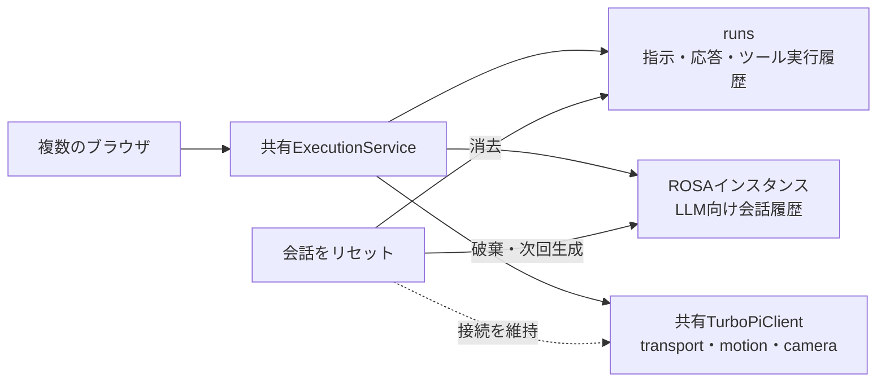

# アーキテクチャ

## 設計の軸

この実装は、自然言語を「引数と制約が決まった操作ツール」に変換し、既存TurboPiへつなぎます。LLMは操作の選択、Pythonコードは実行と制約、既存ROSは機体制御を担当します。

例えば「左に1秒移動して」は、ROSAとLLMが `move_left(duration_s=1)` に変換します。ツールは速度・時間を検証する実行処理へ渡し、実行処理が定周期で速度指令を送り、最後にゼロ速度を送ります。ツールは終了を待って結果を返し、LLMがその結果を説明します。

| 層 | 責務 |
|---|---|
| CLI | 日本語入力・結果表示・直接操作 |
| Web UI | カメラ・チャット・ツール実行履歴の表示、指示送信・中断・会話リセット |
| execution | Webからの指示のバックグラウンド実行、実行履歴、ツール呼び出しの記録・取消 |
| ROSA ＋ LLM | ツールの選択と引数の決定、実行結果の説明 |
| tools | 操作の意味・引数・範囲・戻り値をLLMへ提示 |
| robot | 速度・時間の検証、定周期実行、取消、終了時停止、カメラ画像の取得 |
| transport | rosbridge通信、またはネットワークを使わないモック |
| 既存ROS・制御基板 | 速度指令の車輪指令への変換と機体制御 |

システムプロンプトは、条件確認・順次実行・終了判断・結果に基づく報告の基本ルールに絞ります。各操作の単位・範囲・完了状態はツールのdocstringに記載し、速度・時間の制限はコードでも検証します。

## 全体構成

既存 `turbopi` コンテナを変更せず、WebSocketのrosbridgeを境界として接続します。TurboPiのソース・SDK・コンテナイメージを本リポジトリへ取り込まず、Dockerソケットもマウントしません。ROSA側は専用コンテナと `uv run` のどちらでも実行できます。

実機では各トピックを同じrosbridge接続で利用します。モックでは機体へ接続せず、指令をメモリに記録します。ただしモックのCLI・WebチャットもLLM APIには接続します。カメラは既存ROS側で配信されていますが、本アプリの画像取得ツールは未実装です。

## ROSAへのツール登録

ROSA 1.0.10の標準ツールはROS CLI・rclpyやシステム操作を前提とするため、`RosbridgeROSA._get_tools` をオーバーライドして本アプリのツールだけを登録します。この内部フックへの依存は、ROSA更新時にテストで確認します。`blacklist` はツール名の許可リストではありません。

状態・バッテリーツールは両バックエンドで利用できます。モックでは移動・停止ツールも登録し、実機では `ENABLE_MOTION=true` の場合に登録します。現在の既定値は `true` で、読み取り専用には `false` を指定します。

ツール登録とWebの「利用可能なツール」は `tools/catalog.py` を共通の定義元とします。一覧はツールの説明と入力スキーマから生成し、日本語名・引数・必須／任意・既定値を表示します。ツール一覧の取得はLLMの生成やツール実行を伴わず、APIキーがなくても利用できます。

## Web UI

### 画面とディレクトリ

FastAPIをHTTPサーバー、Jinja2をHTMLテンプレート、htmxを部分更新に使用します。htmx本体とSSE拡張は `web/static/vendor/` に同梱し、CDNへ接続せずに読み込みます。

画面上段はカメラとEXECUTIONの2列、下段はCONVERSATIONと指示入力です。ヘッダーにバックエンドと接続状態、EXECUTIONに実行中断・ツール一覧、CONVERSATIONに会話リセットを配置します。会話ごとの「実行履歴を見る」で、対応するタイムラインを選択できます。

| 場所 | 責務 |
|---|---|
| `web/app.py` | FastAPI生成、共有サービスの生存期間、HTTPルート、SSE配信 |
| `web/templates/index.html` | ヘッダー・カメラ・入力欄・ツール一覧ダイアログ |
| `web/templates/partials/workspace.html` | 実行タイムライン・会話履歴・通知の更新単位 |
| `web/templates/partials/tools.html` | 利用可能なツールの詳細一覧 |
| `web/static/tokens.css` | KaiRA Blueを基調にした色・フォントの定義 |
| `web/static/app.css` / `app.js` | レイアウト、状態表示、履歴選択、スクロール、ダイアログ |
| `execution/service.py` | 指示の実行、ツールの観測、取消、会話リセット |
| `execution/store.py` | 指示ごとの `Run` データモデル |
| `robot/camera/` | 画像取得インターフェース・フレーム情報・カメラモック |

起動は `ROBOT_BACKEND=mock uv run rosa-turbopi-web` です。既定では `127.0.0.1:8000` にバインドします。認証やブラウザごとのセッション分離は実装していません。

### 指示実行と画面更新

Webサーバー起動時にtransport、`TurboPiClient`、`ExecutionService`を作成し、全リクエストで共有します。ROSAは最初の指示を処理するときに生成し、その後の会話で再利用します。チャットにはLLM設定が必要ですが、画面・ツール一覧・カメラモックは設定なしでも利用できます。

`submit()`は処理全体をバックグラウンドのスレッドへ渡し、HTTPリクエストは実行完了を待ちません。同時に実行できる指示は1件で、実行中の二重送信はサーバー側でも拒否します。ツール内の移動処理は、既存の `MotionExecutor` のワーカーを利用します。

SSEはイベントキューを配信する方式ではなく、**0.5秒ごとに履歴のスナップショットを取得してHTMLを生成し、前回と異なる場合だけ送信**します。変化がない場合はkeepaliveを送ります。再接続時は現在のHTMLを送り直すため、ツールを再実行せずに表示を復元できます。短時間に終わるツールでは、実行中の表示を挟まず完了状態が届く場合があります。

タイムラインは実際のツール呼び出しを記録します。呼び出しID・ツール名・引数・結果・状態・所要時間を保持し、指示ごとの `Run.id` に関連付けます。実行中は青みがかったグレー、完了は青、失敗・拒否は赤、取消はグレーとし、記号と文字でも区別します。事前プラン・予定ステップの生成は現時点では未実装です。

履歴選択はブラウザ側で保持し、SSEで最新の指示が届いても、選択中の過去のタイムラインを維持します。新しい会話・ツール結果の追加時は下端へスクロールし、履歴選択だけでは会話欄の位置を動かしません。開始時刻はUTCで保存し、画面では日本時間の `HH:mm:ss` 形式で表示します。

### HTTPルート

| メソッド・パス | 役割 |
|---|---|
| `GET /` | 初期画面 |
| `POST /chat` | 指示の検証・実行受付、workspaceのHTMLを返す |
| `GET /runs/{run_id}` | 選択した指示のタイムラインを含むHTML |
| `GET /events` | workspaceのHTMLをSSEで配信 |
| `POST /stop` | 現在の指示を取消し、移動の停止を要求 |
| `POST /conversation/reset` | 会話・実行履歴とROSAの会話メモリを破棄 |
| `GET /tools` | 使用可能なツール一覧のHTML |
| `GET /camera` | カメラ画像。実機側が未実装の場合は204 |

### 実行の中断と会話リセット

「実行を中断」はLLMを介さず `ExecutionService.stop()` を呼びます。取消フラグを設定し、`MotionExecutor.block(True)`で後続の移動開始を拒否してから、移動が有効なら `motion.stop()` で取消とゼロ速度送信を行います。各ツールの観測ラッパーも取消フラグを確認し、後続のツール呼び出しを拒否します。

進行中のLLM API通信や、すでに開始した状態読み取りを強制終了する機構はありません。ワーカー終了まで新しい指示とリセットは受け付けず、終了時に指示を `cancelled` として記録します。次の指示の受付時に取消フラグと移動開始のブロックを解除します。中断ボタンは実行中だけ有効です。

「会話をリセット」は、実行が終了しているときに `runs` を消去し、ROSAインスタンスを破棄します。次の指示で新しいROSAを生成するため、LLMへ渡す会話履歴も引き継ぎません。ロボット接続とカメラは維持し、履歴の保存・過去セッションへの切替は行いません。ボタンは会話が存在し、実行中でないときだけ有効です。サーバー側でも実行中のリセットを拒否します。

履歴はサーバープロセスのメモリ内だけに存在します。ブラウザの再読み込みでは残り、サーバーの再起動で消えます。全ブラウザが同じ会話・ロボット接続を共有するため、リセットも全画面に反映されます。件数制限や永続化はありません。共有オブジェクトを使うため、Webサーバーは単一プロセス・単一ワーカーで起動します。

終了時は `ExecutionService.close()` で新規受付を止め、取消・移動停止を試みてtransportを閉じます。

### カメラと認識機能の拡張

カメラはWeb専用ではなく、ロボット機能として `robot/camera/` に置きます。`CameraSource.capture()` はフレームID・撮影時刻・画像バイト列・メディアタイプを持つ `Frame` を返します。

- `ROBOT_BACKEND=mock`：既存の動作モックと `MockCamera` を使います。画像は固定SVGで、`GET /camera` から返します。
- `ROBOT_BACKEND=rosbridge`：現在はカメラソースを持たず、画面に「映像未接続」を表示します。

現在のカメラ表示は画像要素による取得で、動画配信や定期的な画像更新は未実装です。実カメラ取得、物体認識、検出枠の重ね描きも今後の対象です。認識処理は `robot/perception/`、ROSA向けツールは `tools/vision.py` に追加し、フレームIDと撮影時刻で認識結果・表示画像・実行履歴を対応付ける構成を想定しています。これらのディレクトリ・ツールはまだ作成していません。

## 実行結果と停止の範囲

MotionExecutorはバックグラウンドのワーカーで指令を送りますが、移動ツールは終了を待ち、最後のゼロ速度送信後に結果を返します。モックと実機で同じ実行処理を使い、重複移動を拒否します。

状態は `idle`、`running`、`completed`、`cancelled`、`failed` です。引数不正などの実行拒否はツールが `rejected` を返します。実機の `completed` は指令送信処理の完了であり、物理的な移動・停止をセンサーで確認した意味ではありません。

既存ROS・SDKコードには指令途絶時の停止監視が見当たらず、基板ファームウェアの挙動は未確認です。通信断やプロセス強制終了時の停止は保証できません。また、既存アプリも `/cmd_vel` に指令を出し得るため、実機では操作元の競合に注意が必要です。

## CLIと検証

`/status` と `/stop`、CLIの直接コマンドはLLMを経由しません。移動実行・LLM応答待ちの間は次のチャット入力を処理できません。終了時は移動の停止を試みてから接続を閉じます。

チャット中は速度指令の定周期ログを出さず、入力プロンプトを保ちます。モックの `move` コマンドでは指令ログと最終状態を表示します。

テストは通信モック・仮想時計・テスト用LLMで、ツールの選択経路、速度・時間制限、停止、エラー、完了結果を検証します。実機や外部LLM APIには接続しません。

Webのテストでは、モックツールの実行記録、HTMLのエスケープ、二重送信の拒否、実行前・走行中の中断、会話リセットによる履歴とROSAの再生成、実行中のリセット拒否、LLM設定なしでのツール一覧取得を検証します。ブラウザでの見た目やスクロール動作は、これらのHTTPテストでは検証していません。
