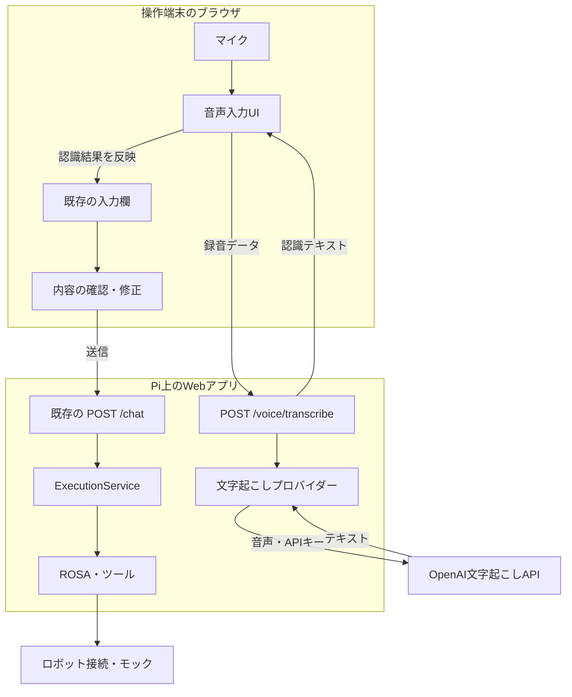
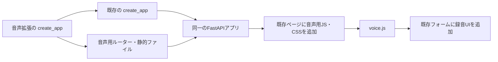

# 音声入力拡張の構成

音声入力拡張は、ブラウザの録音をテキストに変換し、既存Web UIの入力欄へ渡す機能です。
文字起こしまでを `rosa_turbopi_voice` が担当し、確認後の指示実行は
既存の `rosa_turbopi` が担当します。

## 全体構成

録音には操作端末のマイクを使います。音声はPi上のFastAPIを経由してOpenAIへ送り、
認識テキストをブラウザへ返します。APIキーはPi側だけで保持します。



音声入力と手入力は、同じ入力欄と送信経路に合流します。
文字起こしAPIから指示実行サービスへの直接の接続はありません。
会話履歴・実行タイムライン・移動制限・中断処理は既存アプリが受け持ちます。

ブラウザは操作端末の `http://127.0.0.1:8000` からアクセスします。

## ディレクトリ構成

```text
src/
├── rosa_turbopi/                 # 既存のWeb UI・実行管理・ロボット制御
└── rosa_turbopi_voice/           # 独立した音声入力拡張
    ├── __init__.py
    ├── app.py                   # 既存アプリへの拡張の組み込み
    ├── routes.py                # 音声受信・サイズ検証・認識結果の返却
    ├── settings.py              # 音声モデル・APIキー・制限値
    ├── transcriber.py           # プロバイダーの共通インターフェース
    ├── providers/
    │   ├── __init__.py
    │   └── openai.py            # OpenAIへの文字起こしリクエスト
    └── static/
        ├── voice.js             # 録音・キャンセル・入力欄への反映
        └── voice.css            # 音声入力UIの表示
```

`rosa_turbopi_voice` から既存アプリを参照する一方向の依存にしています。
既存の `src/rosa_turbopi/` は音声拡張を参照せず、単独で動作します。

## 既存アプリとの接続

拡張側の `app.py` が既存の `create_app()` を呼び、返されたFastAPIアプリに
音声用ルーターと静的ファイルを追加します。トップページは既存の描画関数を利用し、
生成されたHTMLの `</head>` に音声用JS・CSSの参照を追加します。
テンプレートの複製は行いません。



ロボット接続の生成・終了処理、SSEによる画面更新、チャットと中断のエンドポイントは
既存アプリが管理します。拡張側で別のロボット接続や実行サービスは生成しません。

| 接続先 | 音声拡張での用途 |
|---|---|
| `#chat-form` と `.input-row` | 録音ボタン・状態表示の追加 |
| `#query` | 認識結果の反映・入力変更の検知 |
| `#send` | 録音ボタンの配置位置 |
| `#execution-state[data-busy]` | 指示実行中の音声入力の抑止 |
| `htmx:afterSwap` | 実行状態の変化の検知 |
| `conversationReset` | リセットに伴う音声入力の取消 |

入力フォームが見つからない場合、音声用JSは画面への追加を行いません。
既存HTMLの要素IDやイベントを変更する際は、この接続部分も確認する必要があります。

## 文字起こしの処理

`POST /voice/transcribe` は音声をraw bodyとして受け取り、認識結果だけをJSONで返します。
受信中に容量を確認し、同時に処理するリクエストは1件に制限します。

| 項目 | 内容 |
|---|---|
| 受信形式 | `audio/webm`、`audio/mp4`、`audio/wav` |
| ブラウザの録音形式 | 対応状況に応じてWebM/OpusまたはMP4を選択 |
| 成功時のレスポンス | `{"text": "1秒前進して"}` |
| 録音時間 | ブラウザ側で最大30秒 |
| 音声容量 | ブラウザ・サーバー双方で最大4 MiB |
| API通信のタイムアウト | 45秒 |
| 認識テキスト | 空文字を拒否し、最大4000文字 |

`Transcriber` インターフェースを介してプロバイダーを呼び出します。
OpenAIとの通信・レスポンスの検証・利用者向けのエラー変換は `providers/openai.py` にまとめています。
プロバイダーを差し替える場合も、録音UIや既存の指示実行経路から切り離して変更できます。

## 設定と依存ライブラリ

| 環境変数 | 用途 |
|---|---|
| `OPENAI_API_KEY` | 既存のキーを文字起こしでも共用 |
| `VOICE_TRANSCRIBE_MODEL` | 音声用モデル。既定値は `gpt-transcribe` |

音声拡張は `LLM_MODEL` と `OPENAI_BASE_URL` を使用せず、
`https://api.openai.com/v1/audio/transcriptions` に接続します。

文字起こしには、既存のLLM関連ライブラリも利用するOpenAI公式Python SDKを使います。
`AsyncOpenAI` で非同期に通信し、接続先・タイムアウトを明示します。
SDKによる自動再試行は無効にし、失敗時は利用者へエラーを返します。
音声拡張用のエントリーポイントは `rosa-turbopi-voice-web`、既存版は `rosa-turbopi-web` です。

## 音声データの扱い

音声はブラウザとサーバーのメモリで処理し、アプリ側でディスクや会話履歴に保存しません。
外部APIへ送った音声の取り扱いは、API提供元の契約・設定に従います。
